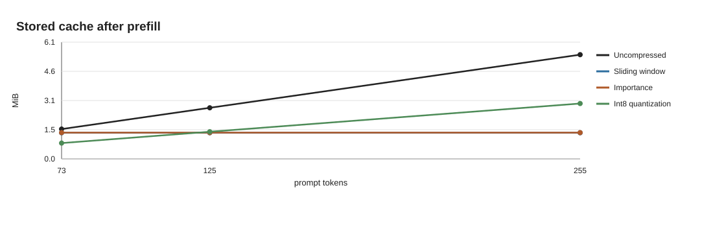
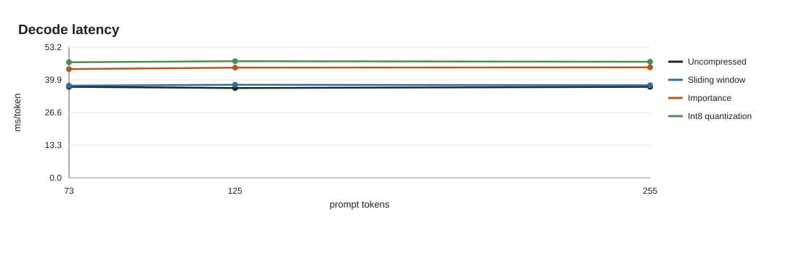
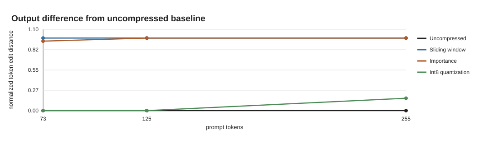

# KV Cache Compression for LLM Inference

This project implements and evaluates three KV-cache compression strategies for autoregressive language-model inference:

1. **Sliding-window eviction** — bounds memory by retaining only the newest cached tokens.
2. **Attention-importance eviction** — retains the tokens that have received the most cumulative attention.
3. **Per-vector int8 quantization** — keeps the complete context while reducing the numerical precision of cached keys and values.

The methods are integrated into an explicit layer-by-layer TinyLlama inference loop so that cache storage, decode latency, and output quality can be measured directly against an uncompressed baseline.

## Why compress the KV cache?

During autoregressive decoding, every transformer layer stores the key and value vectors produced for earlier tokens. Reusing these tensors avoids recomputing the entire prefix for each generated token, but the cache grows linearly with sequence length:

```text
KV bytes = 2 × layers × KV heads × tokens × head dimension × bytes per element
```

The leading `2` accounts for both keys and values. As prompts, output lengths, or batch sizes grow, this memory footprint can limit the number of requests served on a device and increase memory traffic during attention. The implementations here explore two complementary ways to reduce that cost:

- **Token reduction:** keep fewer time steps in the cache.
- **Precision reduction:** keep every time step using a smaller representation.

## Compression methods

### 1. Sliding-window cache

`WindowCache` appends each new key/value pair and retains only the most recent `budget` tokens in every layer.

```text
[older context | newest budget tokens] → [newest budget tokens]
```

When the cache exceeds its budget, the retained suffix is cloned rather than merely sliced. This releases the discarded tensor storage instead of leaving a small view backed by the original allocation. Rotary-position embeddings are applied before caching, while the inference loop separately tracks absolute token positions after the visible cache length stops growing.

**Strengths:** predictable bounded memory, simple implementation, and low bookkeeping overhead.  
**Trade-off:** information outside the recent window is irreversibly removed, which can damage long-range recall.

### 2. Attention-importance cache

`ImportanceCache` also enforces a fixed token budget, but selects tokens using cumulative attention rather than recency.

After each attention operation, the implementation:

1. averages attention weights across the batch and query heads;
2. sums the received attention over query positions;
3. adds the result to each retained token's running score;
4. keeps the top-scoring tokens when the budget is exceeded; and
5. restores the selected indices to chronological order before indexing K, V, and score tensors.

Keys, values, and scores always use the same selected indices, preventing cache misalignment. The current design intentionally has no score decay, protected recent region, or dedicated attention-sink slots, making it a compact baseline for studying importance-based eviction.

**Strengths:** can preserve older tokens that remain influential.  
**Trade-off:** sorting and score metadata add overhead, and cumulative scores may favor old tokens simply because they have existed longer.

### 3. Int8 quantized cache

`QuantCache` keeps every cached token but stores K and V as symmetric int8 tensors. Each token/head vector receives its own float32 scale:

```text
scale = max(abs(x)) / 127
q     = clamp(round(x / scale), -127, 127)
x̂     = q × scale
```

New entries are quantized once and appended without requantizing older cache contents. Full-precision tensors are reconstructed only as temporary attention inputs; the persistent cache remains int8 plus its per-vector scales.

**Strengths:** preserves the full sequence and retained long-range information.  
**Trade-off:** scale metadata and unfused quantize/dequantize operations add runtime overhead.

## Benchmark snapshot

The benchmark used TinyLlama-1.1B-Chat on an NVIDIA L4, greedy decoding, a 64-token budget for the eviction methods, 48 generated tokens, and three repeats per configuration. The 255-token prompt shows the clearest compression trade-off:

| Method | Total cache bytes | Reduction vs. baseline | Decode latency | Normalized token edit distance | Long-range code retained |
|---|---:|---:|---:|---:|---:|
| Uncompressed | 5,744,640 | — | 37.08 ms/token | 0.000 | 3/3 |
| Sliding window | 1,441,792 | 74.9% | 37.72 ms/token | 0.979 | 0/3 |
| Attention importance | 1,447,424 | 74.8% | 45.03 ms/token | 0.979 | 0/3 |
| Int8 quantization | 3,051,840 | 46.9% | 47.30 ms/token | 0.167 | 3/3 |

The eviction approaches achieved the largest memory reduction but failed the long-range recall test at this budget. Int8 quantization used more memory than eviction, yet retained the requested code in every run and exactly matched the baseline output at the two shorter tested prompt lengths. None of the unfused Python implementations improved latency: the experiment reduces persistent storage, but specialized kernels would be needed to turn lower memory traffic into higher throughput.

### Cache memory



### Decode latency



### Output quality



## Repository structure

```text
src/
  inference_server.py   # TinyLlama inference loop and compression selection
  window_cache.py       # Sliding-window eviction
  importance_cache.py   # Cumulative-attention selection
  quant_cache.py        # Per-token, per-head int8 quantization
tests/
  check_window.py
  check_importance.py
  check_quant.py
docs/plots/             # Benchmark figures
```

## Setup

Python 3.10 or newer is recommended.

```bash
python3 -m venv .venv
source .venv/bin/activate
python -m pip install --upgrade pip
python -m pip install -r requirements.txt
```

A CUDA GPU is recommended for timing experiments, but CPU execution is supported for functional testing.

## Run the inference demo

Use `--compression` to select the uncompressed baseline or one of the three methods:

```bash
python src/inference_server.py \
  --device cpu \
  --compression window \
  --cache-budget 64 \
  --prompt "Explain why KV caching accelerates autoregressive decoding." \
  --max-tokens 48
```

Available modes:

```text
none | window | importance | quant
```

The `--cache-budget` option applies to `window` and `importance`. Quantization retains all tokens and therefore does not use an eviction budget.

## Run focused tests

```bash
python tests/check_window.py
python tests/check_importance.py
python tests/check_quant.py
```

The tests verify eviction behavior, K/V alignment, layer isolation, actual backing-storage size, score-based selection, int8 reconstruction error bounds, append behavior, and metadata accounting.

## Takeaways and next steps

- Sliding-window eviction is the simplest way to place a hard upper bound on cache memory.
- Importance selection needs a stronger policy—such as score decay, a protected recent window, and attention-sink tokens—to balance recall and recency.
- Int8 quantization provided the strongest quality-memory trade-off in this experiment.
- Fused quantized-attention and eviction kernels would be necessary to evaluate production throughput fairly.

Natural extensions include hybrid recent-plus-heavy-hitter selection, lower-bit groupwise quantization, cache-aware batching, and evaluation on longer contexts and larger models.
